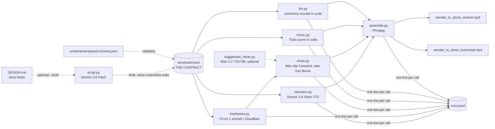

# ARCHITECTURE

How `storyboard.json` becomes an 84.5-second film in 9:16 and 16:9, and why the pipeline is shaped this way. The pipeline was developed on an earlier storyboard (v1–v7) and then produced this film from a completely new one (v8+) with no stage changes beyond small schema additions, which shows the stages are story-agnostic.

## 1. Overview



One command runs it all: `python pipeline/run.py` (see `pipeline/run.py` for the order).

## 2. The contract: `storyboard.json`

Every creative decision lives in one file, so nothing is hidden in code and any run can be reproduced or explained.

| Level | Fields | Used by |
|---|---|---|
| Film | `title`, `slug` (export file names), `version`, `language` (narration `am`, subtitles `en`), `end_card_title` | all |
| Style | `style_block` (appended to every image prompt), `object_glossary` (e.g. what a jebena physically looks like), `characters[]` (fixed description + `reference_image`) | keyframes |
| Defaults | text / TTS / image / video models, `tts_voice`, `tts_style`, `fps` | all model stages |
| Music | `caption`, `tempo_bpm`, `key`, `seed`, `cues[]` (from_shot → to_shot, intent) | music |
| Shot ×8 (v8+) | `id`, `beat`, **`reason`**, `shot_size`, `duration_sec`, `image_prompt`, `motion_prompt`, `camera`, `video_mode`, `seed`, `narration`, `subtitle`, `sfx[]` | every stage |

**Validation runs first, every time** (`pipeline/storyboard.py`):
1. JSON Schema (Draft 2020-12): types, required fields, enums (e.g. `camera`), 8–12 shots.
2. Rules a schema can't express: total 60–90 s including the 3 s end card, unique shot ids, characters defined, subtitles ≤ 84 chars **and** splittable into two 9:16 lines of ≤ 41 chars (E-14), music cues pointing at real shots.

A broken storyboard stops the pipeline **before** any model is called.

## 3. Stages

| Stage | Reads | Writes | Runs where | Model / tool |
|---|---|---|---|---|
| `script.py` (only with `--draft`) | DESIGN.md §2 | `outputs/script/storyboard_draft.json` (+ `storyboard.json` only if absent) | API | `gemini-3.8-flash` → fallback `gemini-3.5-flash` |
| `narration.py` | `shots[].narration`, voice, style | `outputs/narration/sNN.wav`, `timings.json` | API | `gemini-3.8-flash-tts` (Interactions API), voice Kore |
| `keyframes.py` | prompt + character + glossary + style block | `outputs/keyframes/sNN.png` (1024²) | API | `@cf/black-forest-labs/flux-1-schnell` |
| `shots.py` | keyframe, `camera`, `duration_sec`, optional `outputs/wan/sNN.mp4` | `outputs/shots/{vertical,horizontal}/sNN.mp4` | local | FFmpeg `zoompan` (Ken Burns) or Wan clip |
| `music.py` | music cues, tempo, seed | `outputs/music/candidates/{A,B,C}.wav`, `score.wav` (chosen) | local | numpy (Tizita synthesis) |
| `sfx.py` | `shots[].sfx` | `outputs/sfx/sfx.wav` | local | numpy |
| `assemble.py` | all of the above | `outputs/final/<slug>_{vertical,horizontal}.mp4` | local | FFmpeg |
| `kaggle/*.py` | bundle from `kaggle_io.py` | `wan/sNN.mp4`, `music/*.wav`, `*_runs.jsonl` | Kaggle GPU | Wan 2.2 TI2V-5B, ACE-Step 1.5 |

Assembly details: voice is pre-normalised to −16 LUFS and music to −26 LUFS; music is ducked under the voice with `sidechaincompress` (threshold 0.02, ratio 6, attack 300 ms, release 1500 ms); sound effects sit beside the voice, not in the ducked bed (E-10); final loudness is **two-pass** `loudnorm` to −14 LUFS / ≤ −1 dBTP (E-04 → E-08); subtitles are burned in with libass, wrapped per aspect (33 chars for 9:16, 42 for 16:9), lifted above the bottom ~25% of the vertical frame; a 3 s "Made with AI" end card lists every model.

## 4. Caching: why changing one shot regenerates only that shot

Every model call goes through `cached_call()` in `pipeline/common.py`:

```
fingerprint = sha256( stage + provider + model + parameters + seed + inputs )[:16]
```

- `inputs` holds everything the output depends on: the exact prompt text, and the **hashes of upstream files** (a shot clip's fingerprint includes its keyframe's bytes; the final mix includes every narration WAV and the score).
- After a successful call, a sidecar `<output>.meta.json` stores the fingerprint.
- Next run: same fingerprint and the file exists → **skip**, log `status: "cached"`. Different → regenerate.

Consequences:
- Edit s04's narration → only `narration/s04.wav` changes → only the audio mix and the two final exports rebuild. Keyframes, other narration and all clips are cached.
- Edit s04's `image_prompt` → only `keyframes/s04.png` → only `shots/*/s04.mp4` → final exports.
- An unchanged storyboard needs **no API keys**: a clean clone with the committed `outputs/` rebuilds from cache (verified: 0 external calls, 11 s).
- Change a shot's **duration** → narration stays cached (its hash depends on the words, not the length).
- Where a fallback model produced an output, `models_in_cache_order()` tries that model first, so the cache still hits.

## 5. Logging: `runs.jsonl`

One JSON line per call, including cache hits and every failed attempt:

```json
{"timestamp": "...", "run_id": "...", "stage": "narration", "shot_id": "s05", "provider": "google",
 "model": "gemini-3.8-flash-tts", "status": "ok", "attempt": 1, "seed": null,
 "parameters": {"voice": "Kore", "style": "..."}, "input_hash": "...", "latency_sec": 12.6,
 "gpu_minutes": null, "est_list_cost_usd": null, "output": "outputs/narration/s05.wav",
 "error": null, "notes": "audio_seconds=6.38 words=6 words_per_sec=0.94"}
```

`status` is one of `ok`, `cached`, `retry`, `error`. Secret values are scrubbed from error text before writing (`redact()`). `python -m pipeline.costs` turns this log into COSTS.md; Kaggle notebooks write the same format and `python -m pipeline.kaggle_io import` merges them.

## 6. Failure handling

| Failure | Handling | Where |
|---|---|---|
| Transient error | Retry up to 3× with exponential back-off (2 s, 4 s) | `cached_call` |
| 429 / quota / **503 "high demand"** | Back-off of at least 30 s (2 s retries just hit the same wall) | `_is_rate_limit` (F-01) |
| Model overloaded for minutes | Fallback chain to the next Flash model; the model that answered is logged | script, narration, experiments (F-01, F-08) |
| Server stalls without failing | 120 s request timeout turns a hang into a retryable error | `gemini.py` (F-04) |
| Invalid LLM output | Validated against the schema inside the call, so it counts as a failure and is retried | `script.py` |
| A flaky model blocking an unchanged film | The Gemini draft stage is opt-in (`--draft`); a hand-authored storyboard never needs it | `run.py` |
| No GPU / Wan fails / not run | Ken Burns fallback is automatic and per shot | `shots.py` (F-07) |
| Music model fails | Score composed deterministically in code | `music.py` (F-06) |
| Identity drift, text in images | Shot-level prompt specificity, object glossary, re-roll ≤ 3×; corner artefacts fall outside centre crops | keyframes (F-05) |
| Secrets | `.env` git-ignored; `pipeline/check_secrets.py` scans every file to be committed for the real key values before each push | repo |

## 7. What runs where

- **Local (Windows 10, Python 3.15, FFmpeg 9.1):** everything except the GPU notebooks. The film can be rebuilt end to end on a laptop without a GPU.
- **Google AI Studio (free tier):** script, narration, Phase 4 experiment.
- **Cloudflare Workers AI (free tier, 10,000 neurons/day):** keyframes and reference sheet.
- **Kaggle (2× T4, 30 GPU h/week):** optional Wan 2.2 clips and ACE-Step score. Not used in the final film (F-06, F-07).

## 8. Design decisions and trade-offs

- **FLUX.1 schnell over FLUX.2 klein 4B:** klein drifted the character's ethnicity in a side-by-side test (E-05); schnell held it and was ~3× faster. Cost: schnell takes no seed on Cloudflare, so images aren't seed-reproducible; the cache keeps approved frames stable instead.
- **Square keyframes, cropped per aspect:** one generation serves 9:16 and 16:9; the 16:9 crop takes the band 30% from the top because faces sit high (E-08).
- **Ken Burns first, Wan as an upgrade:** guarantees a complete film regardless of GPU availability.
- **Narration sets shot length:** measured TTS timings drive `duration_sec` (E-03: Amharic TTS ≈ 1.1 words/s, half the English rule of thumb).
